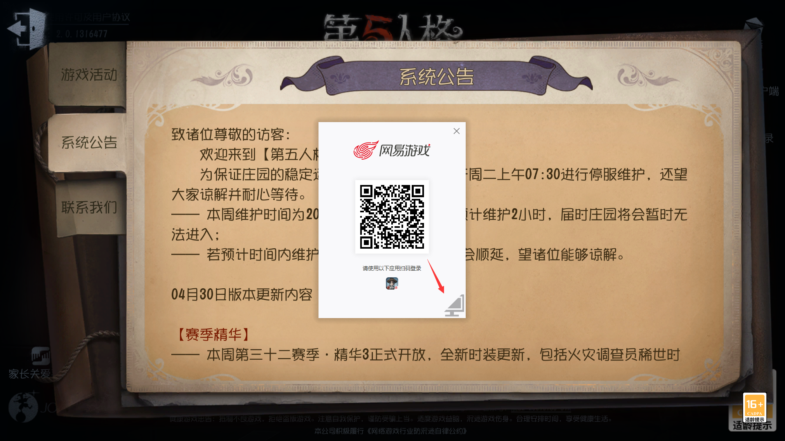

# IdentityV-login-helper


项目仓库：[click](https://github.com/KKeygen/idv-login)
教程：[click](https://kkeygenn.feishu.cn/wiki/J0V4wbm3Bi5LOVkEN7wcvwSEn0e)

## 1. 使用方式

### 独立浏览器版本的要求

此分支不再内嵌 WebView。启动器和需要网页的渠道登录使用独立的 **Firefox 153 ESR 或 158 正式版**；
请从 [Mozilla 官方网站](https://www.mozilla.org/firefox/) 获取，Windows 当前构建面向 Windows 10/11 x64。
不必把 Firefox 设为默认浏览器，工具也不会自动安装它或修改 `auth` / `honorid` 的系统协议关联。
未安装或版本过旧时会显示原生提示，可打开官方下载页、安装后重试，或取消。

工具为 UI、每个账号和平台登录使用各自的专用 profile，不读取日常浏览器的书签、密码或登录状态。
现有账号记录仍保留；旧 Qt 浏览器状态不会直接导入，首次网页登录可能需重新认证。
窗口移动/最大化请使用 Firefox 原生标题栏；关闭启动器窗口不会退出后台代理或下载。

选型、全部渠道/MPay 迁移覆盖、安全边界及尚需平台验收的项目见
[迁移说明](docs/external-browser-architecture.md)。这不是将登录网页交给默认浏览器后忽略回调的实现。

### macOS 用户

请参阅 [macOS 使用教程](docs/macOS-tutorial.md)（仅支持 Apple Silicon）

### 使用预编译版本（Windows）
1. 从本仓库的``release``页下载最新版本的可执行文件(*.exe)
- 本分支的当前 Windows 包要求 Windows 10/11 x64；不要将历史 Python 3.8 包的兼容范围套用到本版本。
- 下载完成后，**强烈建议**校验其``sha256``是否与 ``release``中``.sha256``的值相同。
    如果``sha256``不同，那么您下载的文件是不安全的，可能存在盗号风险，请检查您的网络环境并重新在**官方仓库**下载文件。
2. 您可以使用 ``Windows Powershell`` 的 ``Get-FileHash`` 命令来获取文件的``sha256``值，例如，计算v5.0.0-beta版本的`sha256`可以使用以下命令：
    ```bash
    PS D:\> Get-FileHash idv-login-v5.0.0-beta.exe
    
    Algorithm       Hash
    ---------       ----
    SHA256          <这里会显示HASH值>
    ```
3. 将该压缩文件解压，在解压完的目录中直接右键**以管理员身份运行**下载的可执行文件，例如``idv-login-v5.0.0-beta.exe``，等观察到脚本提示``可以开启游戏``时，保持终端窗口**打开**，然后您可以打开游戏。    
   
4. 打开游戏后，点击登录框**右下角的"电脑"图标**（如下图所示），即可使用账号密码登录，以绕过注册时间限制。



5. 当你成功登录进入游戏大厅后，你可以在本程序界面中使用``Ctrl+C``关闭本程序。

### 预编译版本的构建信息
1. 自`5.3.0`版本，本程序会在构建时内嵌构建信息便于溯源
2. 构建信息的格式为`actionId(commitSHA)`
3. 在 (https://github.com/KKeygen/idv-login/actions/runs/{actionId}) 处能看到本次构建的过程和构建结果的SHA256，参照上方校验方法校验即可确认工具未被篡改

### 手动构建（Optional）

* 在 Python 官网下载 Python [Python.org](https://www.python.org/downloads/release/python-3123/)
* 例：64 位电脑 [Windows installer (64-bit)](https://www.python.org/ftp/python/3.12.3/python-3.12.3-amd64.exe)
* 安装Python时要**使用管理员权限**，自定义(Custom)安装，**添加到Path**、**为所有用户安装**和**pip**。
* 当前源码和打包流程使用 Python 3.12、Windows x64；不支持用历史 Python 3.8 环境构建此分支。
* 下载本仓库对应分支的源码。Windows 平台登录还需已安装的 Microsoft C++ x64 Build Tools。
* 进入解压后的目录，shift+鼠标右键，选择打开Powershell或终端
* 输入以下代码并回车
```bash
pip install -r requirements.txt
# Windows PowerShell，先构建版本锁定的无渲染器 MPay 适配层
./native/mpay_browser_adapter/build.ps1
pyinstaller -F src/main.py -n idv-login-v10beta.exe -i assets/icon.ico --version-file assets/version.txt --uac-admin
```
* 单文件 PyInstaller 示例并不打包平台登录资源；如需发烧 MPay，必须把 `assets/mpay.dll`、
  `assets/mpay_default_skin.zip`、本次源码构建的 `assets/webview_support_helper.dll` 放在程序资源目录，
  并包含匹配的生成清单。推荐使用仓库 `Build and Package` 工作流，它构建并核验这些文件。
  完整接入说明见 [MPay 适配层](native/mpay_browser_adapter/README.md)。

### 渠道服登录

* 在扫码界面以对应渠道扫码一次
* 下次需要登录该区服时，点击扫码登录二维码下方的游戏图标，进入一个浏览器界面
* 在该界面内管理账号登录信息

* 特别地，小米、华为账号登录需要使用手动导入的方式，需要在渠道服管理界面按照提示操作。对于华为账号，每次登录均需要在浏览器中验证，建议在第一次登录华为账号时，使用账号密码登录，信任浏览器并记住密码。

### 如果程序意外退出导致开游戏后无法登录
* 在文件资源管理器里输入`%windir%\System32\drivers\etc`并回车，删除`hosts`文件，即可解除工具对网易登录的劫持。

### 网易第五人格PC端下载
* 大陆 [下载游戏](https://adl.netease.com/d/g/id5/c/gbpc)
* 海外 [下载游戏](https://h55na.gdl.easebar.com/identityv_setup_release_oversea_0112.exe)


## 2. 开源协议
本仓库使用 ``GNU General Public License 3`` 进行开源，请使用/分发本仓库的软件或源代码或衍生产品时请遵守该开源协议，并保留原始项目地址。**需要特别注意的是，根据``GPLv3``许可证的要求，如果你使用了本仓库的代码进行二次开发，那么您的代码也必须使用`GPLv3`协议开源。**

## 3. Bug 反馈
如果您在使用过程中遇到了 ``Bug``, 可以在本仓库提交 `issue` 或者加入QQ群进行反馈。

## 4. 参与本项目

### 贡献渠道服登录方式
以下渠道由于Token过期较快，需要本工具存储渠道服的session（而不是扫码时能接触到的Token）进行刷新。涉及模拟手机端SDK的行为。
| 渠道 | 描述 |
|------|------|
| ~~九游~~ | 已经解决 |
| ~~4399~~ | 已经解决 |

一个渠道服登录实现的类模板在[这里](src/channelHandler/miChannelHandler.py)。

如果你愿意参与本项目的开发，无论是否涉及新渠道服支持，很简单，提交一个Pull request即可。如果有意长期参与开发，请联系我。

## 5. 免责声明
- 一旦您使用本软件，便代表您同意以下所有条款。
- 截至北京时间2024年8月5日，没有**第五人格**用户因使用本程序导致封号，但本软件开发组成员**不保证**使用该软件不会导致封号，您的账号的最终解释权归网易所有，请自行甄别是否使用!**一旦您使用本软件，那么意味着您愿意自行承担使用该软件可能带来的任何风险和后果**
- 由于本软件为开源软件，非官方的二次开发版本有不可控的特性，如果您使用任何非官方版本导致任何后果的，由使用者独自承担全部责任！
- 如有将该软件用于非法目的或造成不良影响后果的，由使用者独自承担全部责任！
- 如果该软件侵犯了网易公司的相关权益，请相关人员及时与我们取得联系，我们将第一时做出处理。

### 6. 赞赏渠道
感谢你的使用！如果这个工具帮到了你，请考虑下赞赏开发者。你的赞赏是我更新工具的动力~


BTC:
> zpub6oDW9BSHBuMqrx5qyzTM4igVZ6ycza1HroAsrSFnnRE91tNQrKAE5m2hwbM24Z8MYWY73kQB3nCH1N9LFwbDRUPa35bpzkZsb7EktaYWMqW

BTC 闪电网络:
> 02b21f493c8aa5be24c5764638e960858727d18c616257a5154b10f47b06840411

## Star History

[](https://www.star-history.com/#KKeygen/idv-login&Date)
